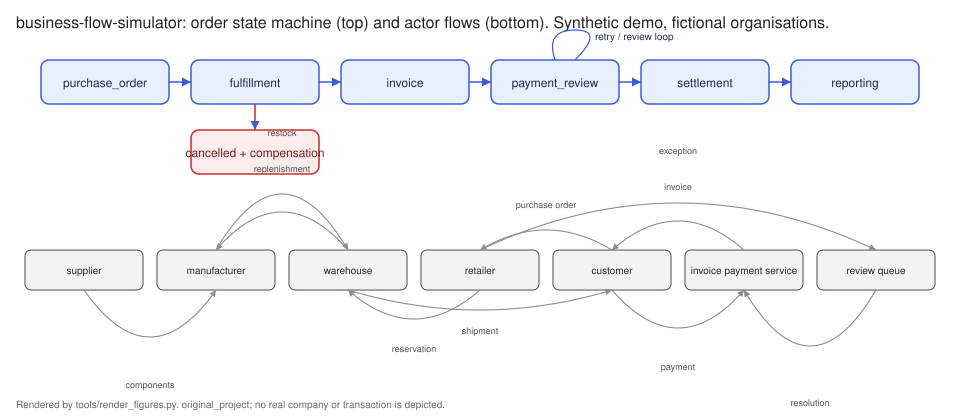

# business-flow-simulator

An operations analyst at a fictional US wholesale distributor wants to know where orders
stall between purchase order and cash, and how exception-handling policy changes cycle
time and review workload. This package is a deterministic discrete-event simulator of
that supplier-to-payment workflow: idempotent, append-only events; a ledger that proves
stock and cash are conserved; fault injection; and three routing policies compared on
identical seeded workloads.

**Status:** `demo_ready` (runs end to end on authored synthetic fixtures; no real-data
evaluation performed in this repository). Project label: `original_project`. Release
2026-09-27, version 0.1.0.

## Problem and user

The user is an operations analyst at "Northwind Demo Supply", a fictional wholesale
distributor selling to fictional retail accounts such as "Blue Harbor Demo Retail". The
questions the tool answers, on synthetic data only:

* Where does an order spend its time: reservation, transit, invoice matching, payment
  review, settlement clearing?
* When a shipment is delayed, an invoice is duplicated, or a payment is declined, what
  happens to that order's state, to the review queue, and to the timing of cash?
* If exceptions are routed to people, to deterministic rules, or to a review team with
  fixed capacity per shift, how do completed orders, cycle-time percentiles, backlog,
  escalations and simulated processing cost differ, on the same input?

It does not answer whether automation pays off in any real organisation. There is no ROI
figure and no causal business claim anywhere in this repository.

## Demo

```
python -m business_flow_simulator demo
```

runs all five scenarios under all three policies on identical seeded workloads and
writes `examples/output/`: the JSON event log for baseline under `rules_automation`,
`kpi_report.csv` (15 rows), one `comparison_<scenario>.json` per scenario, three replay
files for the portfolio's 3D scene (`replay_baseline.json`, `replay_delayed_shipment.json`,
`replay_duplicate_invoice.json`), the baseline scenario as a URL-safe string, a run
manifest, and the figures in `docs/figures/`.

The table below was computed by `python -m business_flow_simulator demo` on synthetic
fixture v1, seed 42, not a benchmark result. Cycle times are simulated minutes from
purchase order to reported; cost is integer cents of a fictional USD scenario with the
assumptions in `configs/assumptions.yaml`.

| scenario | policy | completed | cycle median | cycle p95 | exception rate | review items | auto | escalations | backlog max | stockouts | cost (cents) |
|---|---|---|---|---|---|---|---|---|---|---|---|
| baseline | manual | 60 | 4416.0 | 4436.0 | 0.0667 | 4 | 0 | 0 | 0 | 1 | 11255 |
| baseline | rules_automation | 60 | 4416.0 | 4417.0 | 0.0667 | 2 | 2 | 0 | 0 | 1 | 7655 |
| baseline | capacity_limited_review | 60 | 4416.0 | 4436.0 | 0.0667 | 4 | 0 | 0 | 0 | 1 | 11255 |
| capacity_crunch | manual | 150 | 9128.0 | 15284.6 | 0.4938 | 109 | 0 | 0 | 1 | 304 | 575785 |
| capacity_crunch | rules_automation | 150 | 9118.0 | 15257.6 | 0.4938 | 37 | 72 | 0 | 0 | 304 | 446185 |
| capacity_crunch | capacity_limited_review | 141 | 8965.0 | 15331.0 | 0.4938 | 108 | 0 | 35 | 17 | 304 | 690945 |
| delayed_shipment | manual | 60 | 4416.0 | 7296.0 | 0.45 | 29 | 0 | 0 | 1 | 1 | 56505 |
| delayed_shipment | rules_automation | 60 | 4416.0 | 7296.0 | 0.45 | 27 | 2 | 0 | 1 | 1 | 52905 |
| delayed_shipment | capacity_limited_review | 60 | 4416.0 | 7296.0 | 0.45 | 29 | 0 | 0 | 1 | 1 | 56505 |
| duplicate_invoice | manual | 60 | 4416.0 | 4436.0 | 0.35 | 23 | 0 | 0 | 0 | 1 | 45835 |
| duplicate_invoice | rules_automation | 60 | 4416.0 | 4417.0 | 0.35 | 2 | 21 | 0 | 0 | 1 | 8035 |
| duplicate_invoice | capacity_limited_review | 60 | 4416.0 | 4436.0 | 0.35 | 23 | 0 | 0 | 0 | 1 | 45835 |
| failed_payment_step | manual | 58 | 4416.0 | 4841.9 | 0.3667 | 48 | 0 | 0 | 1 | 5 | 98020 |
| failed_payment_step | rules_automation | 58 | 4416.0 | 4807.9 | 0.3667 | 11 | 37 | 0 | 0 | 5 | 31420 |
| failed_payment_step | capacity_limited_review | 58 | 4416.0 | 5145.3 | 0.3667 | 48 | 0 | 0 | 4 | 5 | 98020 |

Reading it, as a description of the synthetic run and nothing more: the three policies
see the same orders, so completed counts and exception rates agree except where a
capacity-limited queue leaves work unfinished at the horizon (`capacity_crunch`, 141 vs
150 completed, 35 escalations, backlog peaking at 17 items). Rules move duplicate
invoices, small price variances and first payment retries out of the human queue, which
is what lowers `review items` and the simulated cost. The 2,880-minute shipment delay
shows up exactly in the p95 cycle time (7296.0 vs 4436.0) and not in the median, because
30% of orders were affected.



## Implementation status

Works: immutable events; append-only idempotent store with per-correlation ordering
(duplicate ids ignored, gaps buffered, stale versions rejected); inventory and cash
ledger with conservation invariants; order state machine with cancellation and
compensation; seeded workload generator; deterministic engine; five fault types;
retry policy with exponential backoff; review queue in two service models with
escalation; three policies; KPIs; JSON event log, CSV KPI report, comparison JSON,
replay JSON, run manifest; scenario export/import as a URL-safe string; SVG figures;
CLI with eight subcommands; 65 tests.

Not built, on purpose: any adapter to real order or payment systems; any learned model;
any ROI or business-case arithmetic. The `refund` and `return_to_stock` compensation
kinds exist in the ledger and are tested there, but no shipped scenario emits them.

## Quickstart (offline, CPU, under a minute)

```
pip install -e . && pip install pytest        # or: make setup
python -m business_flow_simulator smoke       # fixture run + schema checks, about 2 s
python -m business_flow_simulator demo        # all scenarios x all policies, about 3 s
python -m pytest -q
```

Other commands:

```
python -m business_flow_simulator run --scenario delayed_shipment --policy manual --seed 42 --out build/run
python -m business_flow_simulator compare --scenario capacity_crunch --seed 7 --out build/compare
python -m business_flow_simulator export-scenario --scenario baseline          # prints bfs1....
python -m business_flow_simulator import-scenario --string "bfs1...." --out build/decoded.yaml
python -m business_flow_simulator evaluate --events examples/output/event_log_baseline_rules_automation.json
python -m business_flow_simulator figures
```

Without installing, prefix commands with `PYTHONPATH=src`. Exit codes: 0 success, 1
error with a message on stderr, 2 missing input for `evaluate`.

## Data

There is no external data. See [DATA_CARD.md](DATA_CARD.md) and
[docs/data.md](docs/data.md). Every run consumes a scenario file from
`configs/scenarios/` and a seeded synthetic workload generated from it. The committed
fixture `examples/fixtures/v1/workload_baseline.json` is that workload at seed 42,
labelled in `examples/fixtures/v1/FIXTURE.md`, and a test fails if it drifts from the
generator. To use real operational data you would write an adapter that emits events
conforming to `schemas/event.schema.json`; none is provided.

## Architecture / method

```
customer --PO--> retailer --reserve--> warehouse --ship--> customer
                                          ^  replenish  ^ components
                                   manufacturer <---- supplier
invoice_payment_service: invoice -> three-way match -> payment -> settlement
review_queue: exceptions the policy does not auto-resolve
```

Order states: `purchase_order -> fulfillment -> invoice -> payment_review -> settlement
-> reporting`, with `cancelled` reachable from the first two and a compensation event
that returns reserved stock. Every event is a frozen dataclass with id, timestamp,
correlation id, version, actor, state, status and payload; money is integer cents. The
store applies an event once, so replaying an id cannot double-charge or move stock
twice. Full description in [docs/method.md](docs/method.md); schemas in
[docs/schema.md](docs/schema.md) and `schemas/`.

Policies: `manual` (every exception to two continuous reviewers), `rules_automation`
(four deterministic rules, rest to reviewers), `capacity_limited_review` (every
exception to a queue that starts at most four reviews per eight-hour period). The
reviewer's decision per exception kind is identical across policies, so the comparison
isolates routing and capacity.

## Train, validate, test

Nothing is trained; there are no splits and no model. Testing: `python -m pytest -q`
runs 65 behaviour tests covering immutability, idempotent replay, out-of-order buffering
and stale rejection, ledger conservation after adversarial replays, state-machine
legality, scenario codec round trip and tamper rejection, fixture drift, policy rules at
their boundaries, both queue models, retry recovery and exhaustion, cancellation
compensation, duplicate-invoice detection, byte-identical determinism, horizon cut-off,
and the acceptance case that one injected shipment delay changes the affected order's
state, the queue depth and the settlement time in the same run. See
[docs/evaluation.md](docs/evaluation.md) for the recorded run.

## Results and provenance

Every number in this repository carries the evidence label `demo`: it was computed in
this repository on the authored synthetic fixture and is regenerable from the seed. There
are no `paper-reported` values (this is not a research repository) and no `reproduced`
values (no real-data run has been performed). `examples/output/run_manifest.yaml`
records the configuration hash, the workload hash and the seed for the committed demo.

## Limitations

* Synthetic only. Service times, costs, fault probabilities and reviewer capacity are
  declared assumptions, not measurements. Nothing here transfers to a real organisation
  without calibration that this repository does not perform.
* One SKU catalogue, one warehouse, one retailer. No pricing, credit, returns after
  delivery, taxes or currency conversion.
* Reviewer behaviour is fixed per exception kind; real reviewers disagree and err.
* The capacity queue starts a bounded number of reviews per period and does not model
  shift patterns, weekends or reviewer skill.
* Cycle-time percentiles use numpy linear interpolation over completed orders only;
  incomplete orders at the horizon are reported as a count, not imputed.
* The comparison is descriptive. It cannot support an ROI estimate or a causal statement
  about automation in practice.

## License and sources

MIT, copyright 2026 Md Sultanul Arefin Sourav. See [LICENSE](LICENSE), [NOTICE.md](NOTICE.md)
and [CITATION.cff](CITATION.cff). No third-party code is adapted and no dataset is
redistributed. Dependencies: numpy, pandas, pyyaml; pytest for tests.
